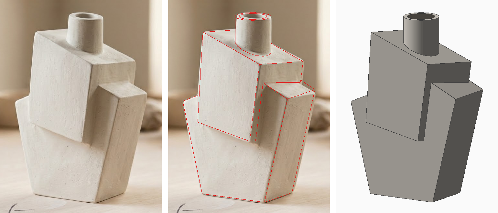
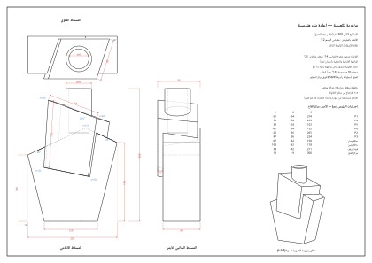
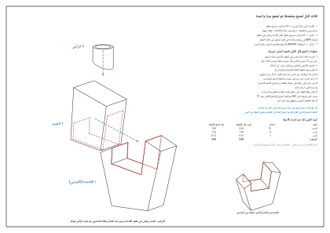

# مزهرية تكعيبية — تحليل هندسي لإعادة الإنتاج

**المعطى:** صورة واحدة ([`reference.jpg`](reference.jpg)) + افتراض أن الارتفاع الكلي **30 سم بعد الحرق**.
**الطريقة:** لم أقدّر الأبعاد بالعين. استخرجت زاوية الكاميرا من الصورة، ثم بنيت نموذجاً ثلاثي الأبعاد بارامترياً وطابقته على الصورة حتى تطابقت حوافه مع حوافها. كل رقم في هذا الملف مقروء من ذلك النموذج.



*يسار: الصورة الأصلية · وسط: حواف النموذج بالأحمر فوق الصورة · يمين: النموذج من الزاوية نفسها. متوسط الخطأ على 11 نقطة تحكّم = 2.0 بكسل ≈ **1 مم** بالمقاس الحقيقي.*

---

## 0. الخلاصة

القطعة ليست مكعبات مكدّسة كيفما اتفق. هي **ثلاثة عناصر فقط**:

1. **قاعدة** تتسع نحو الأعلى، بسقف جمالوني (منحدران).
2. **كتلة علوية مائلة** ملتصقة بواجهة القاعدة وبارزة عنها 12 مم.
3. **عنق أسطواني رأسي** فوق مركز سطح الكتلة العلوية.

**طريقة الإنتاج:** ثلاث كتل مستقلة مغلقة، كل منها بقوالبه الخاصة، ثم تُجمع مرة واحدة بالتهشير والطين السائل (§6):

- **القاعدة على شكل كرسي:** ذراع يسرى منخفضة، وذراع يمنى عالية (الكتف)، ومقعد بينهما.
- **الصدر:** صندوق حقيقي غير منتظم، يجلس في المقعد.
- **الرأس:** العنق فوق الصدر.

> 💡 **أهم اكتشاف:** «الكتف» الذي يبدو في الصورة كتلة ثالثة على اليمين ليس كتلة مستقلة. هو **المنحدر الأيمن لسقف القاعدة**، أي الذراع اليمنى للكرسي، ظاهراً من خلف الكتلة العلوية. حافته الأمامية وحافته اليمنى امتداد مستقيم لحافتي القاعدة حتى سطح الطاولة.

---

## 1. التفكيك الهندسي

الأصل (0,0,0) = مركز قاع القاعدة. **x** نحو اليمين على امتداد الواجهة الأمامية، **y** نحو الخلف، **z** نحو الأعلى. «الواجهة الأمامية» هي الوجه المضاء الكبير في الصورة.

### 1.1 القاعدة — منشور منفرج بسقف جمالوني

| البند | القيمة |
|---|---|
| القاع | **12.0 × 8.4 سم** (النسبة 1.43 ≈ √2) |
| الواجهتان الأمامية والخلفية | **رأسيتان تماماً** (0°) |
| الجانبان الأيسر والأيمن | مائلان للخارج **14°** فيتسع العرض من 12.0 إلى **20.2 سم** |
| ارتفاع الحافة اليسرى | **15.0 سم** (نصف الارتفاع الكلي بالضبط) |
| ارتفاع الحافة اليمنى | **17.8 سم** |
| السقف | منحدران بميل **25°** لكلٍّ منهما |
| قمة السقف (مخفية خلف الكتلة العلوية) | z = **21.1 سم**، وتقع 3.4 سم يمين المركز |
| شكل الواجهة | خماسي غير منتظم، زواياه 104° · 104° · 101° · 130° · 101° |

### 1.2 الكتلة العلوية — منشور مائل (وليست مكعباً مدوَّراً)

| البند | القيمة |
|---|---|
| موضع الواجهة | **موازية** لواجهة القاعدة و**بارزة عنها 12 مم**. لذلك يسقط عليهما الضوء بالدرجة نفسها، ويظهر خط ظل رفيع عند حافتها السفلية |
| رؤوس الواجهة (x, z) سم | P6 (−6.1, 12.2) · P1 (−5.1, 27.4) · P4 (5.8, 23.3) · P5 (3.9, 10.2) |
| الحافة العلوية | تهبط **20.6°** نحو اليمين، وطولها 11.65 سم |
| الحافة السفلية | تهبط **11.3°** نحو اليمين، وطولها 10.2 سم |
| الضلعان الجانبيان | يميلان **3.8°** (يسار) و**8.3°** (يمين) باتجاه عقارب الساعة، أي ميل إجمالي ≈ 6° |
| زوايا الواجهة | 97.5° · 86.9° · 102.4° · 73.2°. هذا التشوّه المقصود هو مصدر الحركة في القطعة |
| العمق | **9.3 سم**، ينحرف **18°** نحو اليمين كلما اتجه للخلف، وينتهي ظهره ملامساً للجدار الخلفي للقاعدة من الداخل |
| السطح العلوي | متوازي أضلاع 11.65 × 9.3 سم بزاويتين 71.4° / 108.6°، يميل 20.6° عن الأفق |
| الجزء السفلي | يغوص داخل القاعدة. في التنفيذ يُبنى الصدر صندوقاً كاملاً يجلس جزؤه السفلي في مقعد القاعدة (§6) |

### 1.3 العنق

| البند | القيمة |
|---|---|
| الشكل | أسطوانة **رأسية**، لا عمودية على السطح المائل |
| القطر | خارجي **5.8 سم** · داخلي **4.5 سم** (سماكة الجدار 6.5 مم) |
| الموضع | مركز السطح العلوي، أي (1.8، −0.9) سم من مركز القاع |
| الحافة العليا | z = **30.0 سم** |
| الارتفاع الظاهر | من **4.0 سم** في الجهة العالية (يسار) إلى **6.2 سم** في الجهة المنخفضة (يمين)، لأن قاعدته مائلة 20.6° |

**الغلاف الخارجي الكلي:** عرض 20.2 × عمق 9.6 × ارتفاع 30.0 سم.

---

## 2. الرسومات الهندسية



الملف [`drawings.svg`](drawings.svg) لوح A3 بمقياس 1:2 ونظام الزاوية الثالثة. يحوي: مسقطاً أمامياً وجانبياً وعلوياً بالأبعاد، وجدول إحداثيات جميع الرؤوس، ومنظوراً من زاوية الصورة نفسها.

---

## 3. الزوايا التي تحتاجها في الورشة

| الزاوية | القيمة | الاستعمال |
|---|---|---|
| انفراج جانبي القاعدة | 14° | دعامة مائلة أثناء التجميع |
| ميل منحدري السقف | 25° | قصّ السقف |
| الزاوية الداخلية بين الجانب والقاع | 104° | شطف الحافة 52° |
| الزاوية الداخلية بين الجانب والسقف | 101° | شطف 50.5° |
| الزاوية الداخلية عند قمة السقف | 130° | شطف 65° |
| ميل سطح الكتلة العلوية | 20.6° | قاعدة العنق |
| انحراف عمق الكتلة العلوية | 18° | وضع الجانبين U4/U5 |

> هذه الزوايا العامة للقطعة. زاوية قطع **كل حافة** بعينها مكتوبة على القوالب بالبنفسجي. قصّ مقاوى (كرتون) بالزوايا التي تتكرر (45° · 52° · 54° · 36°) واستعملها مقاييس عند القطع.

---

## 4. النسب الحاكمة

| النسبة | القيمة | ملاحظة |
|---|---|---|
| حافة القاعدة اليسرى ÷ الارتفاع | 15 ÷ 30 = **½** | منتصف القطعة تماماً |
| عرض القاع ÷ الارتفاع | 12 ÷ 30 = **0.4** | |
| العرض الأقصى ÷ الارتفاع | 20.2 ÷ 30 ≈ **⅔** | |
| عرض القاع ÷ عمقه | 12 ÷ 8.4 ≈ **√2** | نسبة ورق A |
| قطر العنق ÷ الارتفاع | 5.8 ÷ 30 ≈ **⅕** | |
| عرض الكتلة العلوية ÷ عرض القاع | 10.9 ÷ 12 ≈ **0.9** | الكتلتان متقاربتان بصرياً |

إن أردت مقاساً آخر فكبّر أو صغّر كل الأبعاد بالنسبة نفسها، والزوايا لا تتغير.

---

## 5. الكميات

الأرقام للبناء على ثلاث كتل. حيث يجلس الصدر في المقعد يتلاقى جداران، جدار الصدر وجدار المقعد. هذا يزيد الوزن، لكنه يعطي وصلات عريضة متينة ويسند الصدر المائل أثناء الحرق.

| الكتلة | الشرائح | طين رطب صافٍ | بعد الحرق |
|---|---|---|---|
| ١ القاعدة (الكرسي) | 10 | 2.43 كجم | 1.87 كجم |
| ٢ الصدر | 6 | 1.41 كجم | 1.08 كجم |
| ٣ الرأس | 1 | 0.15 كجم | 0.12 كجم |
| **المجموع** | **17** | **3.99 كجم — اطلب 5 كجم** (هدر 25%) | **≈ 3.1 كجم** |

| البند | القيمة |
|---|---|
| الحجم الخارجي | 3.33 لتر |
| السعة الداخلية (جدران 8 مم، قاع 10 مم) | ≈ **1.9 لتر** |
| المساحة الخارجية | 1,552 سم² (لحساب الطلاء أو الصبغة) |

---

## 6. طرق إعادة الإنتاج

### أ) البناء بالشرائح: ثلاث كتل منفصلة — الطريقة الموصى بها

صنع كل كتلة وحدها ثم جمعها مرة واحدة هو **أنسب طريقة لهذه القطعة**:

- كل كتلة صندوق مغلق بسيط، تستطيع إبقاء زواياه حادة وأوجهه مستوية قبل أن يتعقد الشكل.
- الصدر يجلس في مقعد القاعدة، فكل وصلة بين الكتلتين **وجه مستوٍ على وجه مستوٍ**: الأرضية والجداران والظهر. هذا أفضل وضع للتهشير، ولا يحتاج قصاً مائلاً ولا يترك فراغات.



| الكتلة | الشرائح | شكلها عند الانتهاء | وصلتها |
|---|---|---|---|
| **١ القاعدة (الكرسي)** | B1–B7 الغلاف + S1–S3 المقعد | صندوق مغلق: ذراع يسرى منخفضة، وذراع يمنى عالية، وبينهما مقعد مفتوح من الأمام والأعلى. ظهر المقعد هو الجدار الخلفي B2 | يجلس فيها الصدر |
| **٢ الصدر** | U1–U6 | صندوق مغلق كامل الأوجه. فيه فتحة Ø45 للعنق، ونافذة في قاعه تنطبق على نافذة أرضية المقعد | يجلس في المقعد |
| **٣ الرأس** | N1 أو N2 | أسطوانة Ø58/45 قاعدتها مقصوصة بميل 20.6° | يُثبت على سطح الصدر |

**الطين:** طين حجري أبيض مع شاموت ناعم (10–20%)، فهو يقاوم الالتواء في الأوجه الكبيرة. السطح في الصورة مطفأ مع ثقوب دقيقة: إما بسكويت أبيض، وإما زجاج أبيض مطفأ.

**القوالب:** [`templates.pdf`](templates.pdf) — 8 صفحات A3:

| الصفحات | المحتوى | المقياس | ملفات SVG |
|---|---|---|---|
| 1–3 | القاعدة (الكرسي): B1–B7 وS1–S3 | **1:1** رطب | [`templates-1-base-1`](templates-1-base-1.svg) · [`-2`](templates-1-base-2.svg) · [`-3`](templates-1-base-3.svg) |
| 4–5 | الصدر: U1–U6 | **1:1** رطب | [`templates-2-chest-1`](templates-2-chest-1.svg) · [`-2`](templates-2-chest-2.svg) |
| 6 | الرأس: N1 وN2، وشريحة اختبار الانكماش T1 | **1:1** رطب | [`templates-3-neck-1`](templates-3-neck-1.svg) |
| 7 | دليل الجمع | منظور | [`assembly.svg`](assembly.svg) |
| 8 | الرسم الهندسي | 1:2 بعد الحرق | [`drawings.svg`](drawings.svg) |

في أعلى كل صفحة قوالب **مفتاح للألوان**.

- اطبع على ورق **A3 أفقي** بمقياس **100%** («الحجم الفعلي»، لا «ملاءمة للصفحة»)، وتحقّق بالمسطرة المرسومة (100 مم) أسفل كل لوح.
- إن كان انكماش طينك مختلفاً فاطبع بمقياس = 88 ÷ (100 − انكماشك) × 100%. أمثلة: 10% ← 97.8% · 13% ← 101.1%.
- **ابدأ باختبار الانكماش T1 قبل أي شيء.** القوالب محسوبة لانكماش 12%. انكماش طينك الحقيقي هو الذي يحدد الارتفاع النهائي:
  1. اقطع الشريحة T1 واخدش عليها خطّين بينهما 100 مم.
  2. احرقها، ثم قِس المسافة بين الخطين.
  3. إن كانت 88 مم فاطبع القوالب كما هي. وإلا فاطبع بمقياس 88 ÷ القياس × 100%.
- القوالب هي **الشكل الخارجي** للوجه.
- **زاوية قطع كل حافة مكتوبة عليها بالبنفسجي** خارج خط القص، والطول بالأزرق داخله:

| الرمز البنفسجي | المعنى |
|---|---|
| **∠52°** | اقطع الحافة مائلة بحيث تكون الزاوية بين الوجه الظاهر وسطح القطع 52°. الحافة المقابلة في الشريحة الأخرى عليها الرقم نفسه، فتلتقيان بلا فراغ |
| **∠72° على B2** | الحافة تستند على الوجه الداخلي للشريحة B2. اقطعها بهذه الزاوية لتنطبق عليه |
| **∠90° حافة ظاهرة** | حافة تبقى ظاهرة، تُقصّ عمودية |
| **⟂ + حبل** | زاوية داخلية في المقعد: قصّ عمودي، ثم املأ الزاوية من الداخل بحبل طين |

**رموز القوالب:**

| الرمز | المعنى |
|---|---|
| الأحمر المظلل (في B1 وB5 وB6) | جزء يُقصّ ويُرمى ليصنع مكان المقعد |
| الرمادي المتقطع | الشكل الكامل قبل الحذف، للمرجع فقط |
| المخطط البرتقالي (في الصدر) | مساحة تلتصق بالمقعد، تُهشَّر كلها |
| الأحمر المنقط | حافة المقعد على الصدر |
| الإطار الأحمر في U6 وS1 | النافذة المشتركة، تُقصّ من الشريحتين |

#### صنع كل كتلة على حدة

1. **القاعدة (الكرسي):**
   - ابنِ الجدران أولاً: B7 ثم B1 وB2 رأسيتين، ثم B3 وB4 على دعامة 14°.
   - ركّب المقعد والأعلى ما زال مفتوحاً: الأرضية S1، ثم الجداران S2 (يسار) وS3 (يمين).
     - حوافها الأمامية على حواف القص في B1، وظهورها على B2 من الداخل.
     - املأ زاويتي الأرضية مع الجدارين بحبل طين **من الداخل** (⟂ + حبل)، لأنك لن تصل إليهما بعد الإغلاق.
   - أغلق الأعلى بـ B5 وB6.
   - قصّ النافذة في S1.
   - النتيجة صندوق مغلق، لا يدخله إلا ما يدخل من نافذة المقعد.
2. **الصدر:** صندوق مغلق من الشرائح الست كاملة.
   - ابدأ بـ U1 فهي مرجع الشكل، ثم U4 وU5 وU6 وU2، وأغلق بـ U3.
   - قصّ فتحة Ø45 في U3 والنافذة في U6.
3. **الرأس:** إحدى طريقتين:
   - **الدولاب (N2):** ارمِ أسطوانة Ø66/51 مم (رطب) بارتفاع ≥ 75 مم، ثم قصّ قاعدتها بميل 20.6° حسب المقطع.
   - **الشريحة (N1):** لفّها حول أنبوب Ø51 مم، والحِم طرفيها.

**النافذة المشتركة في U6 وS1 إلزامية.** بدونها تصبح القاعدة حجرة مغلقة: لا يصلها الماء، وقد تتشقق أو تنفجر في الفرن من البخار المحبوس. النافذتان في الموضع نفسه، فتنطبقان عند الجمع.

غطِّ الكتل الثلاث بالنايلون حتى تصل **إلى درجة الجلد الصلب نفسها**. اختلاف الرطوبة بين الكتل هو السبب الأول لتشقق الوصلات.

#### الجمع (مرة واحدة)

1. **تجربة جافة:** أدخل الصدر في المقعد من الأمام **كالدُّرج**، باتجاه عمقه (للخلف و18° يميناً)، حتى يلمس ظهرُه جدار القاعدة الخلفي من الداخل.
   - هذا هو الاتجاه الوحيد الذي يدخل منه، لأن جداري المقعد مائلان قليلاً بميل جانبي الصدر نفسه.
   - شذّب أي احتكاك.
   - تحقّق من الموضع (مقاسات رطبة):
     - الواجهة U1 بارزة **13.6 مم** عن B1.
     - زاويتها السفلية اليسرى على **139 مم** من الطاولة، واليمنى على **116 مم**.
2. **التهشير:** خطّط وجوه المقعد الثلاثة وجدار الظهر، والمساحة البرتقالية على الصدر، ثم ادهن الطين السائل على الجهتين.
3. **الإدخال:** أدخل الصدر حتى يلمس الظهر، ثم اضغطه لأسفل وللجانبين حتى يخرج الطين السائل الزائد من الحواف.
4. **التنظيف:** مرّر حبل طين رفيعاً على حواف المقعد من الخارج (الخط الأحمر في الرسم)، وامسح الفائض.
5. **الرأس:** هشّر الحلقة البرتقالية على U3 وقاعدة العنق، ثم ثبّته **رأسياً**:
   - الضلع الأقصر نحو الزاوية P1.
   - الفوهة على **341 مم** من الطاولة (رطب) = 300 مم بعد الحرق.
6. **التجفيف:** جفّف القطعة ببطء ومغطاة لأسبوع تقريباً. **الحرق:** إن كانت القطعة لماء طبيعي فازجج الداخل بطلاء بطانة حتى لا يرشح.

### ب) الصب بالطين السائل — لإنتاج نسخ متعددة

التقسيم نفسه يبسّط القوالب كثيراً، لأن كل كتلة بسيطة.

1. اطبع ثلاثة نماذج أصلية بمقياس **113.6%** (تعويض انكماش 12%)، ثم صنفرها وأغلق مسامها:
   - [`module-base.stl`](module-base.stl): الكرسي بمقعده.
   - [`module-chest.stl`](module-chest.stl)
   - [`module-neck.stl`](module-neck.stl)
2. اصنع قالباً جبسياً لكل كتلة:
   - **الصدر والرأس:** قطعتان تكفيان.
   - **القاعدة:** تحتاج قطعة إضافية للمقعد، لأن جداره الأيسر يميل قليلاً إلى الداخل.
3. اصبب بسماكة جدار 6–8 مم، ثم قصّ النافذة المشتركة واجمع الكتل كما في (أ).

### ج) الطباعة ثلاثية الأبعاد أو الجسمونايت — لقطعة ديكور

- [`vase-hollow.stl`](vase-hollow.stl) (جدران 8 مم) يُطبع مباشرة بالمقياس 1:1 (الوحدة مم)، ثم يُرشّ بطلاء حجري مطفأ.
- أو اطبع [`vase-solid.stl`](vase-solid.stl) واصنع منه قالب سيليكون، ثم اصبب جسمونايت أو إسمنتاً أبيض. هذه أقرب مادة للملمس المنقّط في الصورة.

---

## 7. الملفات

| الملف | المحتوى |
|---|---|
| [`reference.jpg`](reference.jpg) | الصورة الأصلية |
| [`fit-check.png`](fit-check.png) | إثبات المطابقة: الصورة · الحواف فوقها · النموذج |
| [`drawings.svg`](drawings.svg) | الرسم الهندسي (3 مساقط + منظور + جدول إحداثيات) |
| [`assembly.svg`](assembly.svg) | الكتل الثلاث مفككة، والكرسي من الأعلى، واتجاه الجمع، وخطواته، وكمية الطين لكل كتلة |
| [`templates.pdf`](templates.pdf) | ملف الطباعة: 6 صفحات قوالب 1:1 مرتبة حسب الكتلة، ثم دليل الجمع والرسم الهندسي (A3) |
| `templates-<الجزء>-<الصفحة>.svg` | الصفحات نفسها بصيغة SVG |
| `module-base/chest/neck.stl` | نموذج أصلي لكل كتلة على حدة (لقوالب الصب): الكرسي، والصدر، والرأس |
| [`vase-solid.stl`](vase-solid.stl) | النموذج المصمت (بالمليمتر) لعمل نموذج أصلي أو قالب |
| [`vase-hollow.stl`](vase-hollow.stl) | النموذج المجوّف (جدار 8 مم) للطباعة المباشرة |
| [`src/vase.py`](src/vase.py) | المولّد البارامتري الذي أنتج كل ما سبق |
| [`src/templates_pdf.js`](src/templates_pdf.js) | يجمع صفحات القوالب ودليل الجمع والرسم في `templates.pdf` |

---

## 8. المنهجية وحدود الدقة

**استخراج الكاميرا من الصورة:**

| البند | القيمة | المصدر |
|---|---|---|
| زاوية النظر من الأعلى | 12.7° | نسبة بيضاوي فوهة العنق (24 ÷ 109 بكسل). تأكدت بشرط أن زاوية القاع قائمة، فأعطى 11.9° |
| دوران القاعدة عن مستوى الصورة | 32° | الحواف الثلاث الظاهرة للقاع |
| المقياس | 18.98 بكسل/سم | بعد ضبط ارتفاع فوهة العنق على 30 سم |
| نوع الإسقاط | متعامد تقريبي | ميول الحواف في أعلى القطعة وأسفلها متسقة، فتأثير المنظور ضعيف |

**ما قِيس مباشرة من الصورة:** القاع، وانفراج الجانبين، وكون الواجهتين رأسيتين (حُسب انفراجهما فخرج ≈ 0°)، وحافتا السقف الظاهرتان، ورؤوس واجهة الكتلة العلوية، وسطحها، وخط التقائها بالقاعدة، والعنق.

**ما افتُرض لأنه غير مرئي:**

- الظهر يوازي الواجهة.
- المنحدر الأيسر للسقف بميل الأيمن نفسه (25°).
- ظهر الكتلة العلوية نسخة موازية لواجهتها.
- عمق الكتلة العلوية وانحرافها 18°: اختيرا بمطابقة خط التقاء «الكتف» بالكتلة العلوية، فأعطى ذلك عمقاً 9.5 سم. ثم قُصّر العمق 2 مم إلى **9.3 سم** ليستند ظهر الصدر على الجدار الخلفي للقاعدة من الداخل، فيصبح ذلك نقطة التوقف عند الجمع. ارتفع متوسط خطأ المطابقة بسبب ذلك من 1.6 إلى 2.0 بكسل فقط.

**التفاوت المتوقع:** ±2–3 مم في الحواف الظاهرة، و±5–10 مم في الأجزاء الخلفية المفترضة. هذه الأجزاء لا تُرى من زاوية الصورة، فأي خطأ فيها لا يغيّر شكل القطعة كما تظهر.

---

## 9. التحقق من الدقة

كل رقم في هذا الجدول ناتج عن فحص آلي يعيده [`src/vase.py`](src/vase.py) مع كل توليد، وليس تقديراً:

| الفحص | النتيجة |
|---|---|
| مطابقة النموذج على الصورة | 11 نقطة، متوسط الخطأ 2.0 بكسل ≈ **1 مم** |
| الوصلات | 33 وصلة بين 16 شريحة، ولكل حافة نوع وصلة وزاوية قطع |
| تطابق الحواف المتلاقية | **0.0 مم** فرقاً في الطول بين كل حافة والحافة التي تلتقي بها |
| جلوس الصدر في المقعد | التداخل **0.0 سم³**: يدخل بلا احتكاك، وظهره يلمس B2 من الداخل |
| مساحة شرائح الصدر | 760.9 سم² = مساحة سطح الصدر في النموذج تماماً |
| مساحة شرائح القاعدة | 1,199.2 سم² من أصل سطح 1,309.4 سم². الفرق 110 سم² هو ظهر المقعد (الوجه الداخلي لـ B2) والحافة العليا لـ B2، وهما ليسا شريحتين منفصلتين |
| مقياس ملف الطباعة | المسطرة **100 مم**. الشريحة B7 قيست في الملف 95.3 × 136.2 مم، والمطلوب 95.5 × 136.4 مم. الفرق 0.1 مم، وهو حد دقة القياس نفسه |

**ما لا يمكن ضمانه من الورق:**

- **انكماش طينك:** يحدد الارتفاع النهائي (±1 سم لكل ±3% انكماش). لهذا يأتي الاختبار T1 أولاً.
- **الجهة الخلفية:** مستنتجة لأنها لا تظهر في الصورة (±5–10 مم).
- **الدقة اليدوية:** في القص والتجميع.

---

## 10. التعديل

كل القيم في أعلى [`src/vase.py`](src/vase.py)، بالسنتيمتر وبمقاس ما بعد الحرق. غيّر ما تريد ثم شغّل:

```bash
pip install numpy pillow manifold3d shapely
python3 docs/vase/src/vase.py
node docs/vase/src/templates_pdf.js   # إعادة بناء templates.pdf (يحتاج Playwright)
```

يُعاد توليد النماذج والرسومات والقوالب ونسبة المطابقة. أمثلة على التعديل: ارتفاع آخر، أو انكماش طين مختلف (`SHRINK`)، أو سماكة جدار أخرى (`WALL`).
